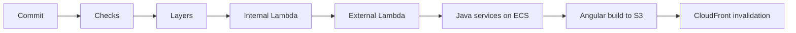

## Delivery pipeline

GitHub Actions workflows divide validation and deployment by application layer.
Shared Lambda layers are deployed before functions that depend on them.
The deployment sequence then covers internal and external serverless applications.
Java services are built into images and deployed to ECS.
The Angular frontend is built and delivered through S3 and CloudFront.

Workflows are split across deploy, build, scan, frontend, backend, infrastructure, and serverless files.
Stage-specific deploy workflows exist for development, QA, UAT, and master.
Pull request checks validate proposed changes before they reach a deployment branch.
The scan workflow provides a separate security and quality check.

## Triggers and releases

Branch and tag filters live in each workflow's `on` block.
Deployments target the environment associated with the selected stage.
Release tags use the `uat-vX.Y.Z` format for UAT releases.
A release deploy is therefore traceable to a versioned source revision.

The repository uses Husky hooks for local checks.
Lint runs before commits and tests run before pushes.
Commit messages follow the gitmoji convention.
SonarQube contributes static analysis to the engineering workflow.
Pull requests use a shared template to keep review context consistent.
Renovate automates dependency update proposals.

Keep the order of layer and consumer deployments intact.
A failed upstream build should stop later deployment jobs.
The frontend deployment includes CDN invalidation so updated assets can be served.
Environment secrets are configured in GitHub rather than stored in workflow files.
Workflow permissions should stay limited to the deployment operations they need.
Use the stage workflow appropriate to the change and release target.

## Change ownership

The workflow split mirrors the different deployment units in the monorepo.
A frontend change can use its frontend workflow without rebuilding unrelated containers.
A Java change follows the backend build and service deployment path.
Serverless layer changes precede internal and external function deployments.
Infrastructure changes use the dedicated infrastructure workflow.

The PR workflow gives reviewers an automated signal before merge.
The scan workflow complements code review with automated analysis.
Branch rules and secrets are repository configuration and may differ by stage.
Consult the workflow files when a trigger or deployment target needs confirmation.
Release tags should refer to a reviewed and stable revision.
Keep deployment logs associated with the source revision for traceability.
