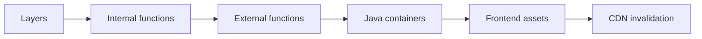

## Delivery order

GitHub Actions builds shared Lambda layers first, followed by internal and external serverless services, Java container images, and finally the frontend assets delivered through object storage and a CDN. This order keeps shared runtime dependencies available before consumers deploy.

Releases use tags in the `uat-vX.Y.Z` format. Husky runs local checks, commits follow the repository's gitmoji convention, and SonarQube contributes static analysis.

