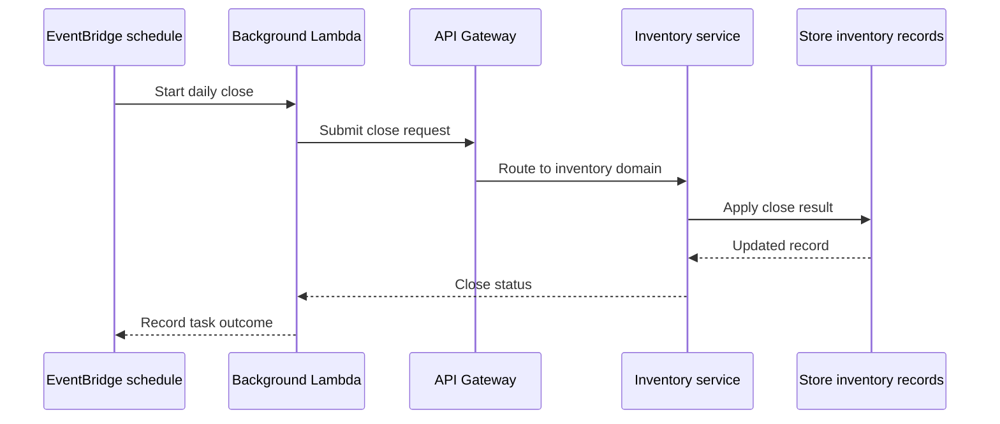
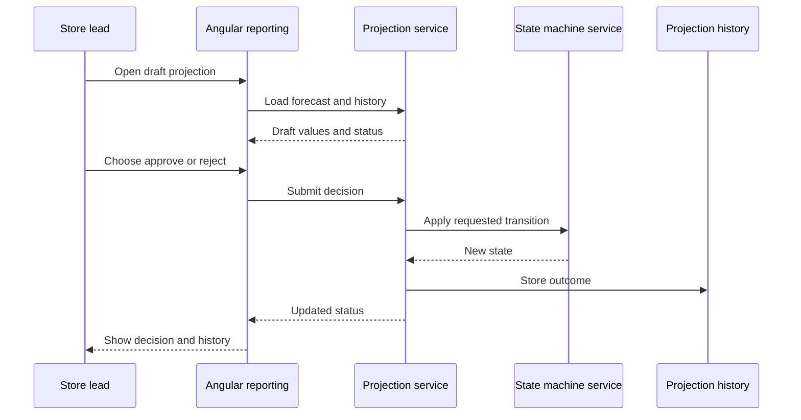
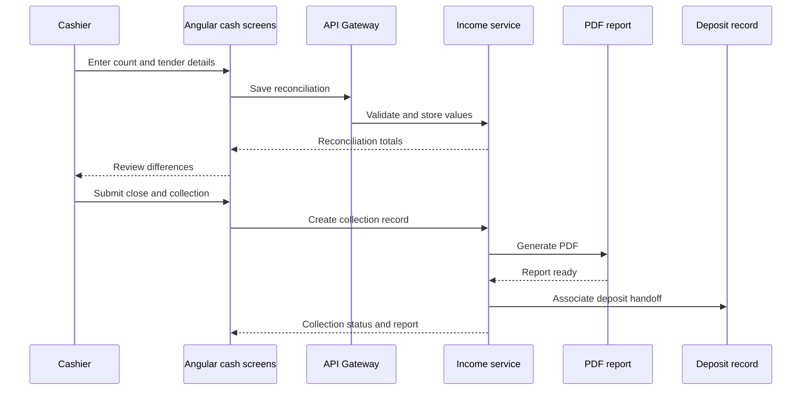

# Key operational flows

The application has both interactive and background paths.

The examples below show how a store action moves through service boundaries.

They describe responsibilities rather than implementation code.

## Daily inventory close

An EventBridge schedule starts the background task after the store day.

The scheduled Lambda prepares and coordinates the close request.

The inventory service applies the close to the store’s daily inventory record.

The service result is available for the inventory workflow to review.

The scheduled entry point keeps the close from depending on an open browser session.

The Lambda and Java service have separate deployment and monitoring paths.

The store team continues to use the Angular inventory screen for count entry.

The background close complements that interactive count workflow.

## Sales projection approval

A projection is prepared for a store and a planning period.

The Angular reporting workflow shows its values and review history.

The projection service asks the state service to move the request through its states.

An authorized reviewer approves or rejects the projection.

The outcome is reflected in the projection history.

The state transition makes the review outcome explicit.

The workflow keeps approval separate from editing the underlying forecast values.

## Cash count and deposit collection

The cashier and reviewer identify the opening and the responsible employees.

Store staff record cash and other tender values against the shift.

The reconciliation view compares entered values with expected totals.

The reviewer checks differences before submitting the reconciliation.

The income service prepares a PDF record for a cash collection or reconciliation.

The collection record stays connected to the deposit handoff.

The safe control screen records cash movement into or out of the safe.

The exact sequence depends on the store’s configured cash process.

## Request path

Interactive workflows use the same authenticated API entry point.

The user signs in and completes email MFA.

Cognito issues a token for the application session.

API Gateway invokes the custom authorizer for a protected request.

An approved request is routed to the responsible service.

The service validates domain rules and returns a scoped response.

Some calls route through VPC Link to a Java service on ECS Fargate.

Other calls invoke a Lambda handler directly.

## Asynchronous work

Some work begins after the initiating API request has completed.

EventBridge starts scheduled tasks and reacts to configured events.

SQS holds messages between a producer and its handler.

The consumer can retry work independently from the browser request.

Email MFA and scheduled inventory close use this separation.

The interface should present the processing state where a user needs to follow the outcome.

The service remains the owner of the final business record.
