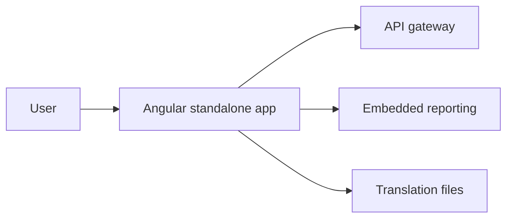

## Angular application

The web client uses Angular 19 with standalone components and Nx workspace tooling. Tailwind supports application styling, while translations are delivered from object storage. Sentry provides client-side error reporting.

The application covers inventory, daily close, purchases, projections, sales, employees, and embedded analytics. Backend calls pass through environment-specific API endpoints.

