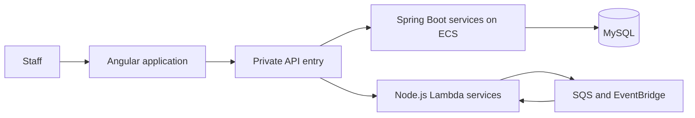

## A platform for daily operations

The system supports inventory counts and closeouts, purchases, sales, projections, employee workflows, and reporting. It combines a browser application, domain services, event-driven workers, and infrastructure managed as code.

The system is a team effort. This case study describes its architecture at a useful level without exposing customer identifiers, credentials, internal endpoints, or API contracts.
