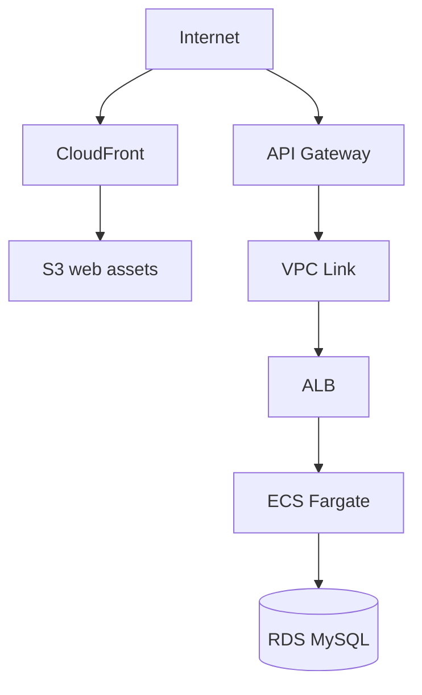

## Infrastructure as code

Terraform provisions AWS resources for four stages: development, QA, UAT, and master.
The repository separates reusable modules from the stage configuration that composes them.
The checked-in module directory contains the following named modules:

| Module | Responsibility |
| --- | --- |
| `ecs-task-definition` | Defines task runtime settings for container workloads. |
| `apigw_backend_integration` | Connects API Gateway routes to backend targets. |
| `apigw_custom_domain` | Configures the API's custom domain. |
| `cloudfront` | Delivers the web application at the edge. |
| `cloudwatch_filter_metrics` | Creates metrics from selected log patterns. |
| `apigw_backend_integration_no_auth` | Integrates routes that do not use the application authorizer. |
| `alb` | Routes private service traffic through an application load balancer. |
| `ECS` | Defines the container cluster. |
| `certificates` | Manages TLS certificates. |
| `database_secrets` | Stores database connection secrets. |
| `security_groups` | Restricts network paths between resources. |
| `rds_mysql` | Provisions the relational database. |
| `jump_box` | Provides controlled operational access. |
| `hosted_zone` | Manages DNS records for the environment. |
| `ecs_services` | Defines deployable ECS services. |
| `apigw_private_link` | Connects API Gateway to private load balancer targets. |

The directory currently exposes 16 module folders in the source snapshot.
Each stage supplies its own configuration and resource naming.
The same module can therefore be used with stage-specific settings.

CloudFront handles static frontend delivery while API Gateway exposes application APIs.
The private link path keeps container services behind the load balancer.
MySQL stores transactional domain data used by Java services.
Lambda integrations handle event and API workloads alongside ECS.
Terraform also provisions secrets and the access controls around network paths.
The certificate and hosted zone modules support environment domains.
CloudWatch log filters turn selected operational events into metrics.
The jump box is reserved for controlled operational access.

A stage deploy should use its matching workflow and variables.
Review a plan before applying infrastructure changes.
Keep credentials in the secret store rather than committed configuration.
The module list describes infrastructure responsibilities, not every AWS resource instance.

## Operational boundaries

API Gateway is the public API entry point described by this architecture.
The private VPC Link connects gateway traffic to the application load balancer.
ECS Fargate hosts the Java service workloads behind that load balancer.
RDS MySQL is the relational persistence layer for those transactional services.
CloudFront distributes the browser application from S3.

The modules express reusable resource patterns while stages provide environment values.
Security groups control which components can communicate over the network.
Secrets are managed separately from checked-in Terraform source.
Certificates and DNS resources support secure stage-specific endpoints.
CloudWatch filters support operational metrics from logs.
Infrastructure plans should be reviewed before they are applied.
Changes to shared modules can affect more than one stage.
The list reflects module folders present in this source checkout.
