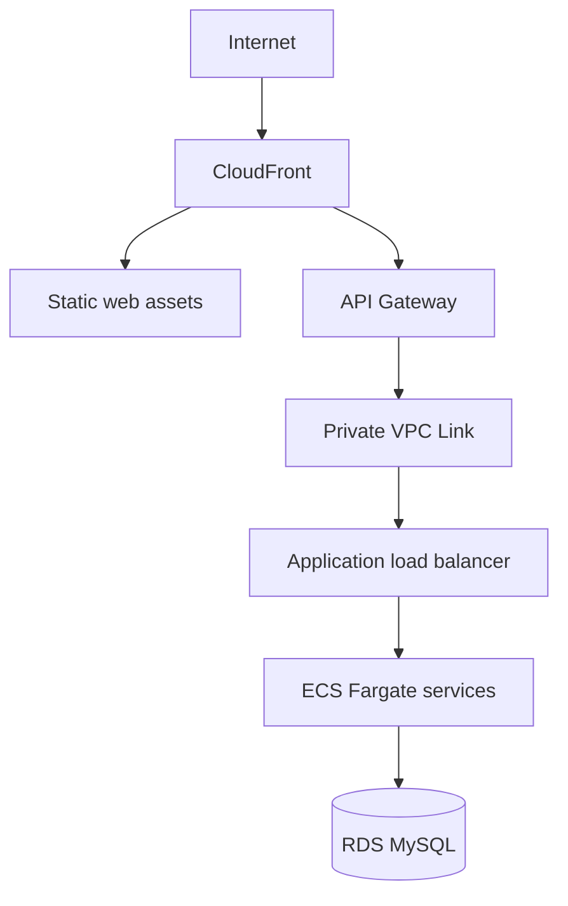

## Infrastructure as code

Terraform manages container registries and ECS services, load balancing, API Gateway with a private VPC Link, edge delivery, relational data, secrets, hosted zones, and operational access. The same patterns are applied to development, QA, UAT, and master stages.

Private integration reduces direct exposure of service endpoints and requires deliberate routing, security group, and stage configuration.
