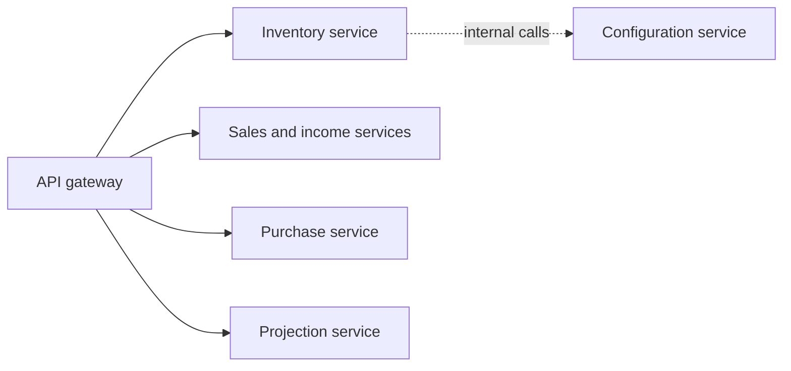

## Domain services

Fourteen services use Java 17 and Spring Boot. They run as containers on ECS Fargate and communicate through HTTP clients where synchronous coordination is appropriate. Service boundaries follow operational domains such as inventory, purchases, projections, and user management.

Independent services allow focused deployment and ownership, while introducing the usual costs of distributed tracing, compatibility, and network failure handling.
