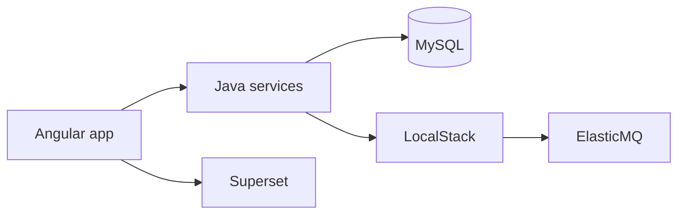

## Local services

Docker Compose starts MySQL, a local identity provider, LocalStack, ElasticMQ, and Superset. Developers can run the Angular application and backend services against these local dependencies.

Local credentials and customer data are not part of this documentation. Use the team's approved setup instructions for any project-specific configuration.
