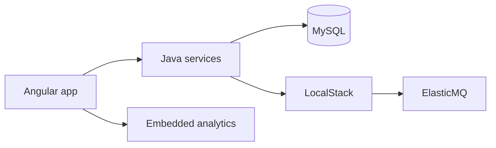

## Local services

Docker Compose provides a repeatable set of supporting services for development.
The configured stack includes MySQL, a local Cognito-compatible identity service, LocalStack, ElasticMQ, and Superset.
The Angular application and Java services can run against these dependencies.

MySQL supports local relational data used by transactional services.
The identity emulator supports authentication integration work without a hosted identity tenant.
LocalStack stands in for selected AWS services used during development.
ElasticMQ provides a local queue endpoint for asynchronous workflows.
Superset makes the embedded analytics experience available in a local environment.

## Working safely

Use the repository's approved setup instructions for project-specific configuration.
Do not copy customer data into local fixtures or screenshots.
Keep local credentials and environment overrides outside tracked source files.
Use fictional records when validating UI states.

The browser application is an Angular standalone-component app.
Java services own transactional domain operations and persistence.
Serverless functions handle selected API, event, queue, and scheduled work.
Local emulators make it possible to exercise integrations without deploying each change.
The services still have independent runtime configuration and should be started as needed.

A useful local workflow is to start dependencies first, then the backend required by the feature.
Start the frontend after the API host and identity settings are available.
Check service logs when a page remains in a loading state.
Confirm the selected stage configuration points only to local or fictional endpoints.
Never use production endpoints as a shortcut for local testing.

## Service boundaries

The local stack reflects the same broad boundaries as the deployed system.
The browser talks to APIs while Java services own domain transactions.
Lambda integrations use AWS-style services that LocalStack can emulate.
Queued work can be exercised through the local message broker.
Superset supports the reporting experience embedded in the frontend.

Compose coordinates local dependencies but does not replace service configuration.
Developers may start only the dependencies needed for their current feature.
Keep test data fictional and scoped to the local environment.
Use logs to distinguish a missing dependency from an application error.
Do not expose local emulators on an untrusted network.
Reset local data only when the team workflow permits it.
Do not commit local overrides or generated credentials.
