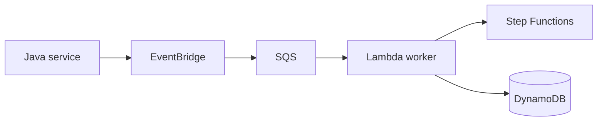

## Event processing

Twelve Node 20 and TypeScript services use Serverless Framework v3. A shared dependency layer and InversifyJS-based composition are used across functions. EventBridge rules, SQS queues, Step Functions, and DynamoDB coordinate asynchronous work.

Inventory closeout processing runs in the background so longer work does not hold up the interactive request. Queued consumers can retry and scale independently, with the added need to monitor retries and failed messages.

